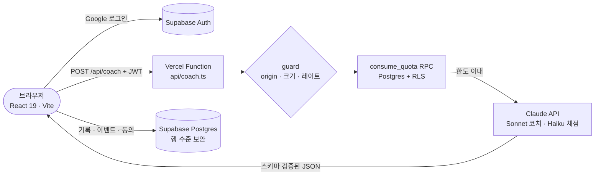

<a href="https://lo9os.org">
  
</a>

<p align="center">
  <a href="https://lo9os.org"></a>
  
  
  
  
  
</p>

<p align="center">
  <b><a href="https://lo9os.org">바로 써 보기</a></b> ·
  <a href="README.md">English</a> ·
  <a href="docs/product/README.md">제품 문서</a> ·
  <a href="DESIGN.md">디자인 시스템</a> ·
  <a href="mailto:contact@lo9os.org">contact@lo9os.org</a>
</p>

---

## 답하지 않는 AI

AI에게 물으면 결론이 바로 나옵니다. 편하긴 한데, 어느 순간 내가 그 결론을 *왜* 믿는지 설명하지 못하게 됩니다.

**LOGOS**는 그 반대 습관을 훈련하는 웹 서비스입니다. 결정을 앞둔 고민이나 쓰려는 주장을 가져오면, 코치는 답도 조언도 의견도 주지 않습니다. 한 번에 질문 하나씩 던져서 내 전제와 빈틈을 스스로 찾게 하고, 결론은 **내가** 씁니다.

> **모든 세션의 규칙은 하나, AI는 질문만 합니다.**

지금 [lo9os.org](https://lo9os.org)에서 한국어와 영어로 쓸 수 있습니다. 만 18세 이상 대상입니다.

## 할 수 있는 것

| 세션 | 하는 일 | 시간 |
|---|---|---|
| **3분 진단** | 주어진 문항에 내 입장을 씁니다. 코치와 분리된 채점관이 기준점을 매깁니다. 로그인 없이 할 수 있습니다. | 약 3분 |
| **코칭 세션** | 내 고민을 4단계 질문으로 파고든 뒤, 결론을 직접 씁니다. | 약 15분 |
| **오늘의 논증** | 입장과 근거를 쓰고 반문 3라운드를 거친 뒤, 스스로 정리합니다. | 약 10분 |
| **아레나** | AI 스파링 상대와 3라운드 토론하고, 내 발언만으로 판정을 받습니다. | 약 10분 |

분석·세션 기록 화면에서 점수와 사고가 어떻게 달라지는지 볼 수 있습니다.


## 화면

<table>
  <tr>
    <td width="50%"></td>
    <td width="50%"></td>
  </tr>
  <tr>
    <td colspan="2"></td>
  </tr>
</table>

## Claude를 쓰는 방식

AI 응답은 모두 서버 엔드포인트 하나(`api/coach.ts`)를 거쳐 Claude가 만듭니다.

| 역할 | 모델 | 쓰는 곳 |
|---|---|---|
| 코치 | `claude-sonnet-5-5` | 코칭·논증·아레나 턴, 세션 리포트 |
| 채점관·심판 | `claude-haiku-5-5` | 루브릭 채점, 아레나 판정 |

- **질문만 한다.** 코치 프롬프트는 답·조언·의견을 금지하고, 한 번에 질문 하나만 허용합니다. 지시문을 보여 달라는 요청에는 응하지 않고 원래 주제로 돌아오는 질문을 합니다. 의료·법률·자해 같은 위기 신호가 보이면 코칭을 멈추고 전문 도움을 권합니다.
- **채점은 코칭과 분리한다.** 채점은 별도의 Haiku 호출이 100점 루브릭으로 사용자가 쓴 글만 평가합니다. 코치가 자기 질문을 스스로 채점하는 일은 없습니다.
- **구조화 출력.** 모든 응답은 Zod 스키마(`server/logos/schemas.ts`)로 검증합니다. 거절·잘림·파싱 실패는 어설픈 답 대신 명확한 오류로 처리합니다.
- **프롬프트 캐싱.** 시스템 프롬프트는 고정 텍스트로 두고 `cache_control: ephemeral`을 붙입니다. 바뀌는 값(단계·anchor)은 user 턴에 넣어서 긴 세션에서도 캐시가 유지됩니다.
- **비용 방어선.** 요청마다 Origin 허용 목록, 64KB 본문 제한, 레이트 리밋(`server/logos/guard.ts`)을 거친 뒤 Postgres의 사용자별 한도(`consume_quota` RPC)를 확인합니다. 세션 종류별 하루 한도는 `shared/quotas.ts` 한 파일에 있고, 요금제 페이지도 같은 값을 읽습니다.

## 구조



- Anthropic API 키는 서버에서만 읽습니다. 브라우저에는 Supabase publishable 키만 있고, 접근 제어는 행 수준 보안(RLS)이 맡습니다. `service_role` 키는 어디에도 쓰지 않습니다.
- 보안 헤더(CSP, HSTS, `X-Frame-Options: DENY`, Permissions-Policy)는 `vercel.json`에서 설정합니다.

## 기술 스택

| 영역 | 도구 |
|---|---|
| 프론트엔드 | React 19, Vite, TypeScript, Tailwind CSS, Radix UI / shadcn, Recharts, Three.js(3D 동상) |
| 백엔드 | Vercel Functions, `@anthropic-ai/sdk`, Zod |
| 데이터·인증 | Supabase Auth(Google OAuth), 행 수준 보안을 적용한 Postgres, `supabase/migrations`의 SQL 마이그레이션 |
| 품질 | Vitest 단위 테스트, RLS·KPI SQL을 검사하는 PGlite 테스트(`supabase/tests`), `tsc --noEmit` |

## 로컬에서 실행

```bash
pnpm install
cp .env.example .env.local   # ANTHROPIC_API_KEY와 Supabase URL·publishable 키를 채운다
pnpm dev                     # http://localhost:3000

pnpm check                   # 타입 검사
pnpm test                    # 단위·DB 테스트
pnpm build
```

변수 설명은 `.env.example`에 있습니다. Anthropic 키에 `VITE_` 접두사를 붙이면 브라우저 번들에 들어가니 절대 붙이지 마세요.

## 폴더 구성

```text
api/coach.ts          Vercel Function 진입점: 모든 AI 동작을 받는 엔드포인트 하나
server/logos/         프롬프트, Claude 클라이언트, guard, quota, 스키마(+ 테스트)
client/src/pages/     Landing, Diagnostic, ThinkingSession, Argue, Arena, Analytics …
client/src/i18n/      한국어(원문)·영어 사전, 키 일치를 타입으로 검사
shared/quotas.ts      서버와 요금제 페이지가 함께 쓰는 하루 한도
supabase/             마이그레이션, RLS·KPI용 PGlite 테스트
docs/product/         PRD, 기능 명세, 유저 플로우, IA, 검토
DESIGN.md             색·타이포·레이아웃 규칙
```

## 신뢰와 개인정보

- 가입할 때 공개된 [이용약관](https://lo9os.org/terms)과 [개인정보 처리방침](https://lo9os.org/privacy)에 동의합니다. 동의한 약관 버전과 시각은 서버에 저장합니다.
- AI가 만든 내용을 보여 주는 화면에는 "LOGOS 코치는 AI예요. 답이 틀릴 수 있어요."라고 표시합니다.
- 만 18세 이상만 이용할 수 있습니다.

## 문서

| 문서 | 내용 |
|---|---|
| [docs/product/PRD.md](docs/product/PRD.md) | 문제, 타깃, 성공 지표, 범위 |
| [docs/product/FEATURE_SPEC.md](docs/product/FEATURE_SPEC.md) | 요구사항 R1~R9와 예외 |
| [docs/product/USER_FLOWS.md](docs/product/USER_FLOWS.md) | 유저 플로우 F1~F8 |
| [docs/product/IA_SCREENS.md](docs/product/IA_SCREENS.md) | 라우트와 화면 설계 |
| [docs/API_CONTRACT.md](docs/API_CONTRACT.md) | `/api/coach` 요청·응답 규약 |
| [DESIGN.md](DESIGN.md) | 디자인 시스템 |

## 라이선스

코드는 공개돼 있지만 권리는 모두 보유합니다. 읽는 것은 자유이고, 복제·재배포·서비스 운영에는 서면 허락이 필요합니다. 자세한 내용은 [LICENSE](LICENSE)에 있습니다.

## 연락처

문의·피드백·제휴: **[contact@lo9os.org](mailto:contact@lo9os.org)** · [lo9os.org](https://lo9os.org)

<sub>한국에서 Claude와 Claude Code로 만들었습니다.</sub>
