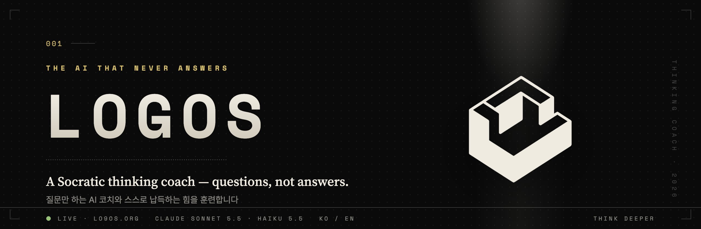
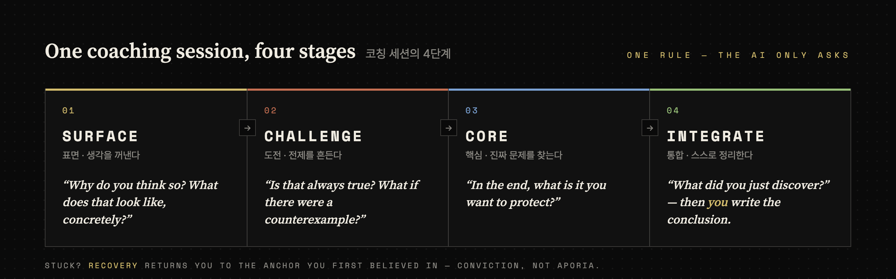
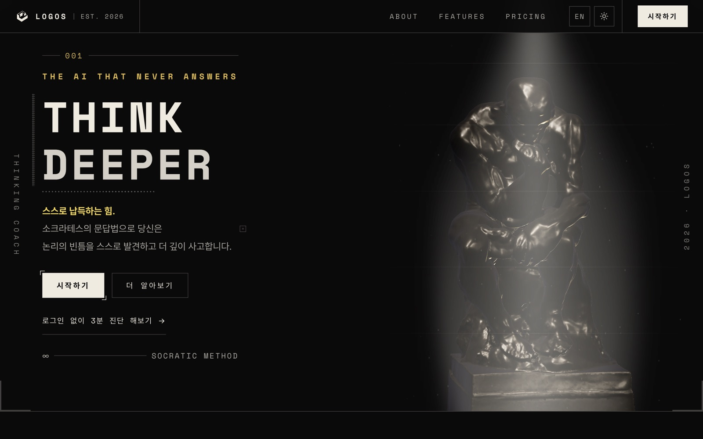
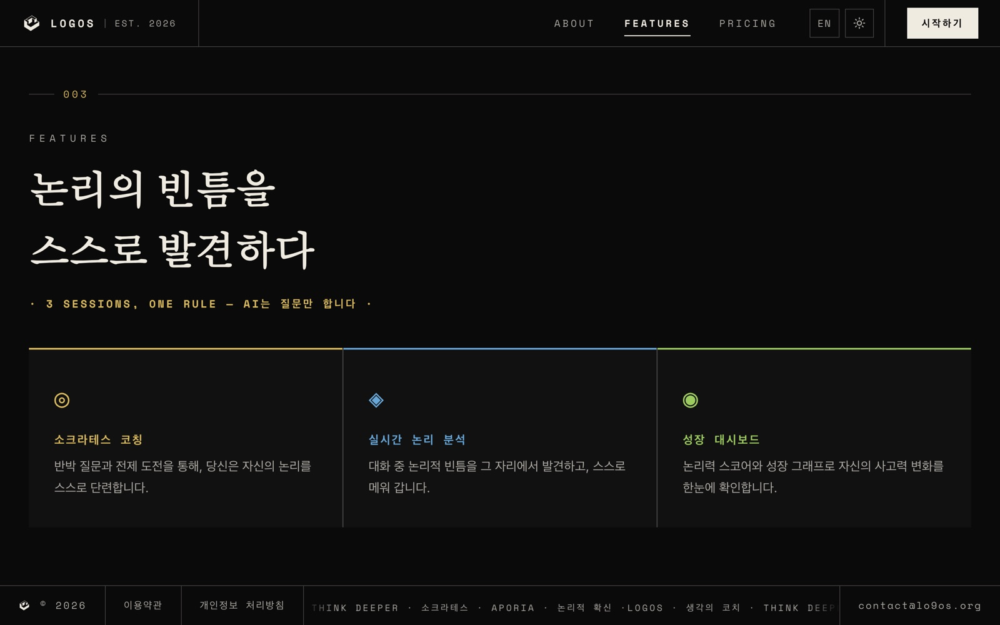
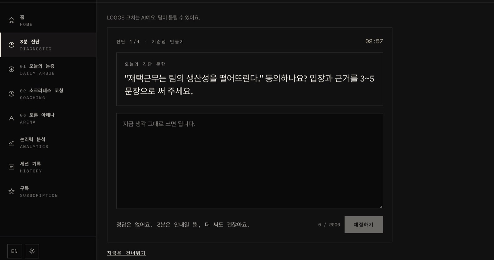
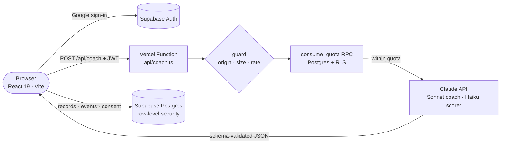

<a href="https://lo9os.org">
  
</a>

<p align="center">
  <a href="https://lo9os.org"></a>
  
  
  
  
  
</p>

<p align="center">
  <b><a href="https://lo9os.org">Try it live</a></b> ·
  <a href="README.ko.md">한국어</a> ·
  <a href="docs/product/README.md">Product docs</a> ·
  <a href="DESIGN.md">Design system</a> ·
  <a href="mailto:contact@lo9os.org">contact@lo9os.org</a>
</p>

---

## The AI that never answers

Most AI tools hand you a conclusion. That is useful, until you notice you can no longer explain *why* you believe it.

**LOGOS** is a web app that coaches the opposite habit. Bring a decision you are stuck on or a claim you want to make. The coach does not give answers, advice or opinions. It asks one question at a time until you find your own premises and gaps, and then **you** write the conclusion.

> **One rule across every session: the AI only asks.**

LOGOS is live at **[lo9os.org](https://lo9os.org)** in Korean and English, for adults 18 and over.

## What you can do

| Session | What happens | Time |
|---|---|---|
| **3-minute diagnostic** | Write your position on a prompt. A separate scorer sets your baseline. No login needed. | ~3 min |
| **Coaching session** | Take your own question through four stages of Socratic questioning, then write your conclusion. | ~15 min |
| **Daily argument** | State a position and your reasons, face three rounds of counter-questions, then summarise it yourself. | ~10 min |
| **Arena** | Debate an AI sparring partner for three rounds, then get judged on your own arguments. | ~10 min |

Analytics and session history show how your score and reasoning change over time.



## Screenshots

<table>
  <tr>
    <td width="50%"></td>
    <td width="50%"></td>
  </tr>
  <tr>
    <td colspan="2"></td>
  </tr>
</table>

## How Claude powers LOGOS

Every AI turn runs on Claude through a single server endpoint, `api/coach.ts`.

| Role | Model | Used for |
|---|---|---|
| Coach | `claude-sonnet-5-5` | coaching turns, argument turns, arena turns, session reports |
| Scorer / judge | `claude-haiku-5-5` | rubric scoring and arena judging |

- **Questions only.** The coach prompt forbids answers, advice and opinions, allows one question per turn, and returns to the topic when asked to reveal its instructions. Crisis signals (medical, legal, self-harm) stop the coaching and point to professional help instead.
- **Scoring is kept apart from coaching.** A separate Haiku call scores only what the user wrote, with a fixed 100-point rubric, so the coach is never asked to grade itself.
- **Structured outputs.** Every response is validated against a Zod schema (`server/logos/schemas.ts`). Refusals, truncation and parse failures become a clear error rather than half an answer.
- **Prompt caching.** System prompts are fixed text marked `cache_control: ephemeral`; the changing stage and anchor go in the user turn, so long multi-turn sessions keep hitting the cache.
- **Cost guardrails.** Each request goes through an origin allowlist, a 64 KB body limit and rate limiting (`server/logos/guard.ts`), and then a per-user quota checked in Postgres (`consume_quota` RPC). Daily limits per session type live in one file, `shared/quotas.ts`, which the pricing page reads too.

## Architecture



- The Anthropic API key is read only on the server. The browser holds only Supabase's publishable key, and row-level security handles access control. No `service_role` key is used anywhere.
- Security headers (CSP, HSTS, `X-Frame-Options: DENY`, Permissions-Policy) are set in `vercel.json`.

## Tech stack

| Layer | Tools |
|---|---|
| Frontend | React 19, Vite, TypeScript, Tailwind CSS, Radix UI / shadcn, Recharts, Three.js (the 3D Thinker) |
| Backend | Vercel Functions, `@anthropic-ai/sdk`, Zod |
| Data & auth | Supabase Auth (Google OAuth), Postgres with row-level security, SQL migrations in `supabase/migrations` |
| Quality | Vitest unit tests, PGlite tests for RLS and KPI SQL (`supabase/tests`), `tsc --noEmit` |

## Run it locally

```bash
pnpm install
cp .env.example .env.local   # fill in ANTHROPIC_API_KEY and the Supabase URL + publishable key
pnpm dev                     # http://localhost:3000

pnpm check                   # type check
pnpm test                    # unit + database tests
pnpm build
```

`.env.example` explains each variable. Never give the Anthropic key a `VITE_` prefix, or it will end up in the browser bundle.

## Project layout

```text
api/coach.ts          Vercel Function entry: one endpoint for every AI action
server/logos/         prompts, Claude client, guard, quota, schemas (+ tests)
client/src/pages/     Landing, Diagnostic, ThinkingSession, Argue, Arena, Analytics …
client/src/i18n/      Korean (source) and English dictionaries, type-checked for parity
shared/quotas.ts      daily limits shared by the server and the pricing page
supabase/             migrations and PGlite tests for RLS and KPIs
docs/product/         PRD, feature spec, user flows, IA, review
DESIGN.md             colour, type and layout rules
```

## Trust and privacy

- Users accept the published [Terms of Service](https://lo9os.org/terms) and [Privacy Policy](https://lo9os.org/privacy) at sign-up. The accepted version and time are stored on the server.
- Screens that show AI output say so ("LOGOS coach is an AI and can be wrong.").
- The service is for adults 18 and over.

## Documentation

| Document | What it covers |
|---|---|
| [docs/product/PRD.md](docs/product/PRD.md) | problem, target users, success metrics, scope |
| [docs/product/FEATURE_SPEC.md](docs/product/FEATURE_SPEC.md) | requirements R1–R9 and edge cases |
| [docs/product/USER_FLOWS.md](docs/product/USER_FLOWS.md) | user flows F1–F8 |
| [docs/product/IA_SCREENS.md](docs/product/IA_SCREENS.md) | routes and screen design |
| [docs/API_CONTRACT.md](docs/API_CONTRACT.md) | `/api/coach` request and response contract |
| [DESIGN.md](DESIGN.md) | design system |

## Contact

Questions, feedback or partnership: **[contact@lo9os.org](mailto:contact@lo9os.org)** · [lo9os.org](https://lo9os.org)

<sub>Built in South Korea with Claude and Claude Code.</sub>
