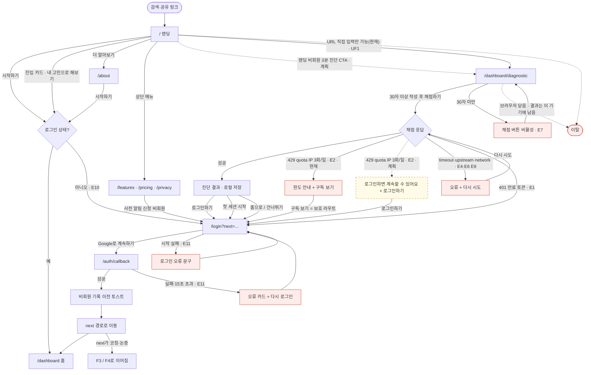
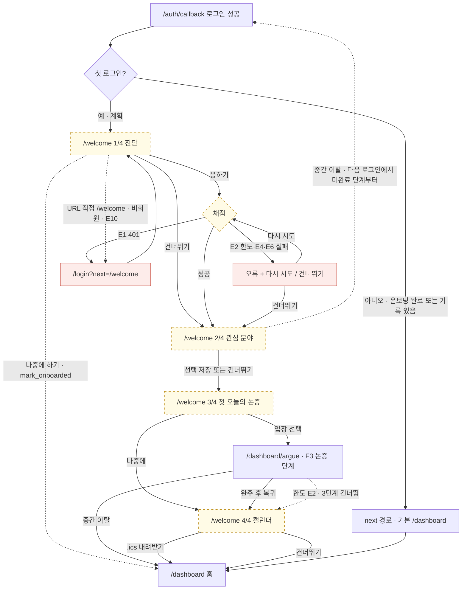
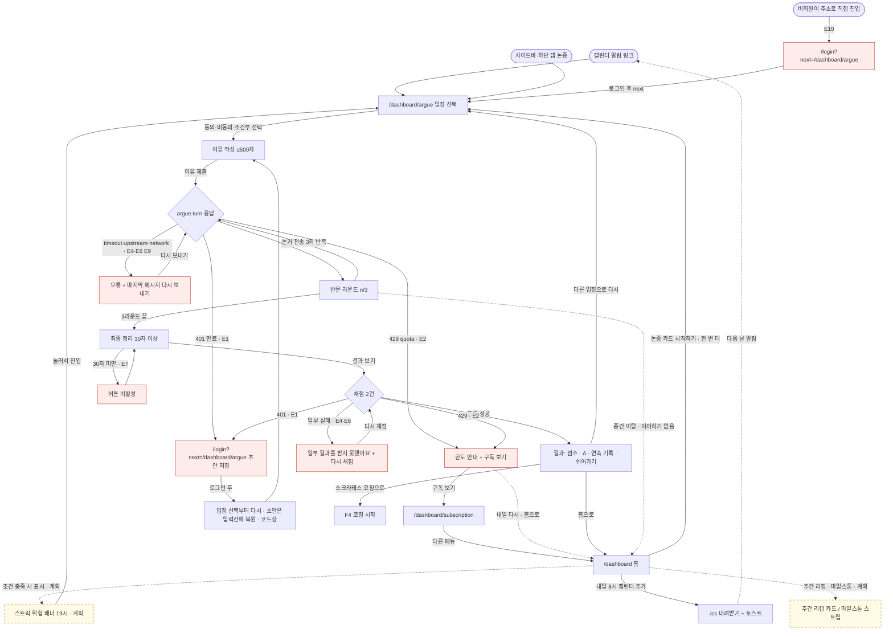
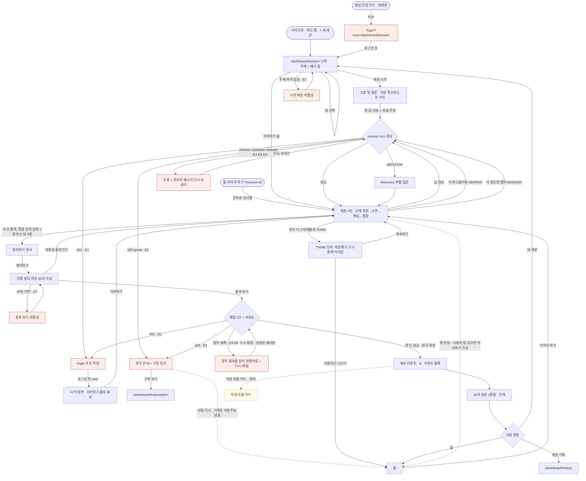
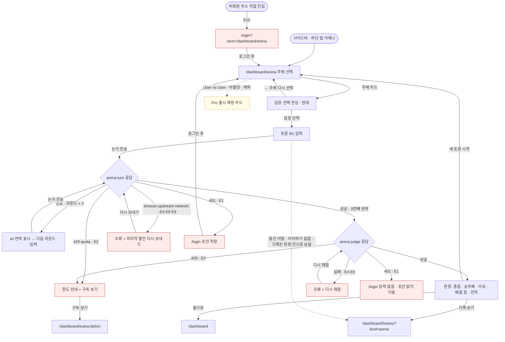
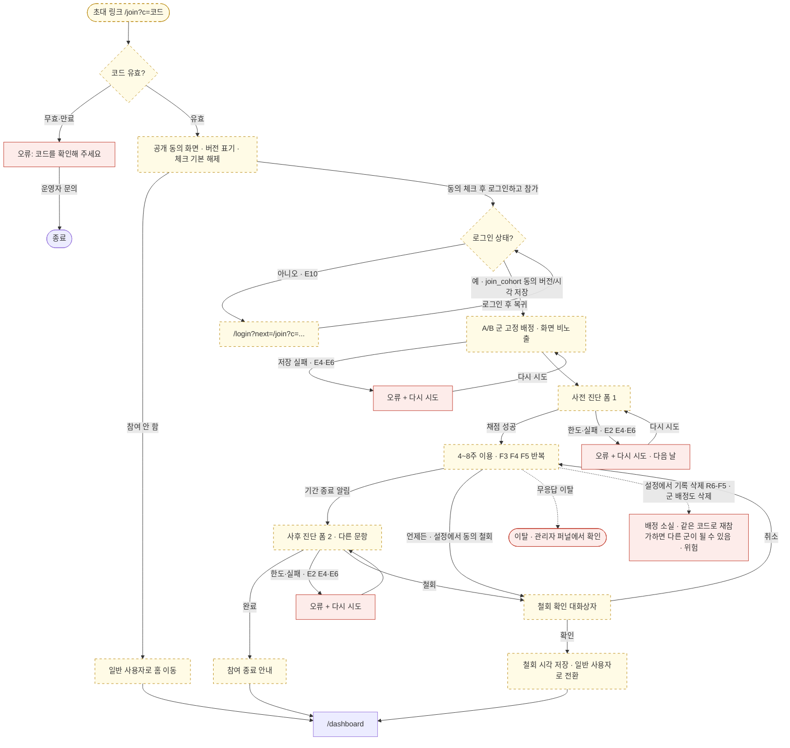
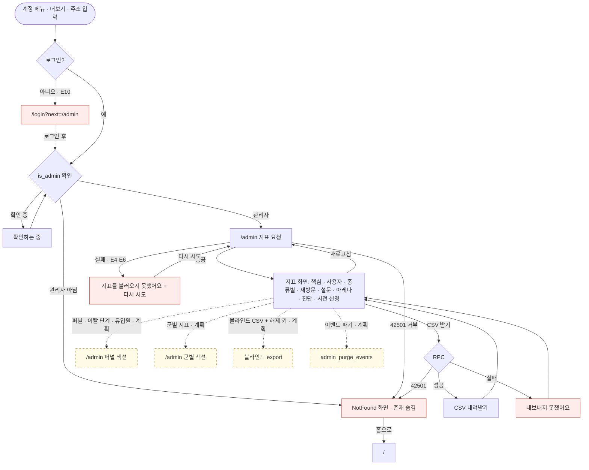
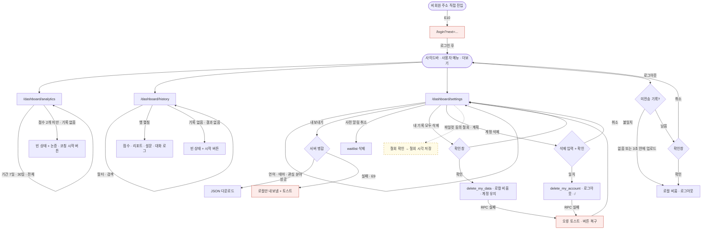

# LOGOS 유저 플로우

작성 2026-10-13 · 상태: 초안 (구현 확인 기준 = `UX uplift` 머지본, 기능 ID·예외 번호는 FEATURE_SPEC에 정합 완료) · 관련 문서: [PRD](PRD.md), [FEATURE_SPEC](FEATURE_SPEC.md), [IA_SCREENS](IA_SCREENS.md), [REVIEW](REVIEW.md)

## 0. 읽는 법

- 순서: PRD(왜) → FEATURE_SPEC(무엇) → **USER_FLOWS(어떤 순서로)** → IA_SCREENS(어느 화면에서).
- 상태 표기: **구현됨** = 코드를 읽고 확인한 것 / **계획(Phase 2)** = main에 아직 코드 없음(2026-10-13 기준 브랜치 `claude/retention-kpi`에 구현, PR 대기) / **갭** = 구현은 있으나 흐름이 끊기거나 빠진 곳.
- Mermaid에서 실선 노드 = 구현됨, **점선 테두리 노드(`planned`)** = 계획(Phase 2), **붉은 테두리 노드(`exc`)** = 예외·오류 화면.
- 기능 ID는 FEATURE_SPEC 체계(R1..R9, Rn-Fm)를 쓴다. 공통 예외는 FEATURE_SPEC §0.4의 `E#`, 명세 갭은 FEATURE_SPEC §3의 `G#`를 그대로 쓴다. 이 문서가 플로우 단위로 찾은 갭은 `UF#`(아래 "발견한 플로우 갭")로 구분하고 FEATURE_SPEC 갭과의 대응을 표에 적었다.
- 코드 근거는 `client/src/...`(`UX uplift` 머지본 기준)로 적는다. 실행해 본 것이 아니라 코드를 읽은 결과이므로, 실제 동작과 다르면 "코드상"이라고 표시한다.

### 사용자 유형

| 유형 | 정의 | 주 플로우 |
|---|---|---|
| 비회원 | 로그인하지 않은 방문자 | F1 |
| 신규 가입자 | 처음 로그인한 사용자 | F2 |
| 재방문 사용자 | 기록이 있는 로그인 사용자 | F3, F4, F5, F8 |
| 파일럿 참가자 | 초대 코드로 들어온 검증 대상 사용자 | F6 |
| 관리자 | `is_admin` RPC가 true인 계정 | F7 |

### 공통 예외 처리

FEATURE_SPEC §0.4의 번호(E1~E11)를 쓴다. 이 문서 초안이 따로 매겼던 E1~E7은 폐기했다. 플로우마다 같은 예외가 반복되므로 먼저 한 번 정리하고, 각 다이어그램에서는 `E#`로 가리킨다. E3(IP 레이트)·E5(서비스 준비 중)·E8(Origin)은 E4·E6과 같은 `ErrorLine` 줄로 보이므로 다이어그램에 따로 그리지 않았다.

| ID | 상황 | 코드가 실제로 하는 일 | 근거 |
|---|---|---|---|
| E1 | 401 / 세션 만료 | `handleAuthError`가 방금 보낸 글을 `sessionStorage` 초안(`logos.draft:<경로>#<칸>`, 최대 20,000자)으로 저장하고 `/login?next=<경로+쿼리>`로 보낸다. 로그인 후 `next`로 돌아오면 `useDraft`가 입력칸이 비어 있을 때 초안을 채운다. 안내 문구 없이 조용히 복원한다. 로그아웃·계정 전환 때 초안은 모두 지운다. | `lib/api.ts:handleAuthError`, `lib/draft.ts`, `components/logos-ui.tsx:useDraft`, `lib/sync.ts:onSignIn` |
| E2 | 일일 한도 초과 (HTTP 429, `code: quota`) | `ErrorLine`이 "오늘 한도를 다 썼어요 · 내일 다시 이용할 수 있어요" + **"구독 보기 →"** 링크(`/dashboard/subscription`)를 보여 준다. 재시도 버튼은 없다. 서버 `reason`(`day`·`refs`·`ref_calls`)은 화면에서 구분하지 않는다. 한도: 코칭 2/일, 논증 3/일, 아레나 3/일, 진단 2/일, 로그인 사용자 하루 호출 100, 하루 기준은 한국 시간 자정. 비회원 진단은 IP당 3/일(서버 메모리, best effort). **계획(Phase 2, 2026-10-13 결정)**: 비회원 진단이 한도를 넘으면 "내일 다시" 대신 로그인 유도 문구와 로그인 버튼을 보인다. | `components/logos-ui.tsx:149`, `shared/quotas.ts`, `server/logos/handler.ts:262-272` |
| E4·E6 | AI 타임아웃·실패 | 클라이언트 55초 타임아웃(`timeout`: "AI 응답이 늦어지고 있어요…"), 502(`upstream`: "AI 응답을 받지 못했어요…"). 화면은 `ErrorLine` + **다시 시도 / 마지막 메시지 다시 보내기**. 재시도는 같은 `sid`로 보내 판 수가 두 번 늘지 않는다(호출 수는 늘어 한도를 더 쓴다). 채점·리포트가 일부만 성공하면 "일부 결과를 받지 못했어요."와 **다시 채점**을 보이고, 이미 받은 결과는 다시 요청하지 않는다. | `lib/api.ts`, `pages/ThinkingSession.tsx:submitSummary` |
| E7 | 입력 길이 위반 | 입력칸이 `maxLength`로 초과 입력을 막고 글자 수를 보여 준다. 코칭 주제 200자, 코칭·아레나 메시지 1000자, 논증 이유 500자, 최종 정리 1500자(최소 30자), 진단 답 2000자(최소 30자). 최소 글자 미달이면 제출 버튼이 비활성이다. 서버가 `bad_request`를 주면 "내용을 조금 줄이거나 다시 써 보세요." 일반 문구만 나온다. | 각 페이지 상수, `i18n/ko/errors.ts` |
| E9 | 오프라인·동기화 대기 | `navigator.onLine`은 보지 않는다. 요청이 실패하면 "네트워크 연결을 확인해 주세요."(`network`) + 재시도. 기록은 로컬 저장이 먼저이고 서버 전송은 outbox에 쌓아 2초에서 60초까지 늘려 가며 다시 보낸다. 미전송 건수는 **"동기화 대기 N"**으로 표시한다(데스크톱 사이드바 계정 영역, 사이드바를 접으면 점, 모바일 상단 아바타의 점). 로그아웃 때 3초 안에 올려 보고 남으면 확인창을 띄운다. | `lib/sync.ts`, `components/DashboardLayout.tsx` |
| E10 | 비회원이 보호 라우트 접근 | `RequireAuth`가 "확인하는 중…"을 잠깐 보인 뒤 `/login?next=<경로+쿼리>`로 보낸다. 로그인하면 `next`(같은 사이트 경로만 허용)로 돌아온다. 공개 라우트: `/`, `/about`, `/features`, `/pricing`, `/privacy`, `/login`, `/auth/callback`, `/dashboard/diagnostic`(계획: `/welcome`은 로그인 필요, `/join`은 공개 진입 후 로그인). | `App.tsx`, `components/RequireAuth.tsx`, `lib/auth.tsx:safeNext` |
| E11 | 로그인 오류 | 로그인 시작 실패: "로그인을 시작하지 못했어요." / 콜백에서 세션이 안 잡히거나 15초 초과: 오류 카드 + **다시 로그인** 링크. Supabase 환경 값이 없으면 "로그인 준비 중이에요." | `pages/Login.tsx`, `pages/AuthCallback.tsx` |

---

## F1. 비회원 첫 방문

- **사용자**: 비회원. **시작**: 검색·공유 링크로 `/` 도착. **종료**: ① 진단 결과를 보고 로그인 / ② 시작하기로 로그인 / ③ 이탈.
- **관련 기능**: R8-F1 랜딩, R8-F2 소개·기능·요금·개인정보, R8-F3 SEO·메타, R8-F4 UTM·referrer first-touch(계획), R1-F1 3분 진단, R1-F2 진단 결과, R6-F1 로그인, R6-F3 비회원 기록 이전, R7-F2 퍼널 이벤트(계획), R7-F9 대기자 명단.
- **현재 구현의 핵심 사실**: 랜딩의 모든 시작 버튼은 `/dashboard`, `/dashboard/session`, `/dashboard/argue`로 가며 전부 보호 라우트라 로그인 벽에 먼저 닿는다. 비회원이 쓸 수 있는 진단(`/dashboard/diagnostic`)은 **랜딩 어디에서도 링크되지 않는다**(주소를 직접 열어야 한다). 즉 "랜딩 → 3분 진단"은 현재 끊겨 있다(UF1, FEATURE_SPEC G17). 2026-10-13 결정에 따라 Phase 2에서 랜딩에 비회원 3분 진단 CTA를 추가해 이 구간을 잇는다(다이어그램의 점선·`planned` 노드). 같은 결정으로 비회원 진단이 한도를 넘으면 "내일 다시" 대신 로그인을 유도한다(E2).

### 단계 표

| # | 화면/라우트 | 사용자 행동 | 시스템 반응 | 상태 | 기능 ID |
|---|---|---|---|---|---|
| 1 | `/` 랜딩 | 히어로 읽기, "시작하기" 또는 "더 알아보기" | 시작하기 → `/dashboard`, 더 알아보기 → `/about`. 이탈 방지 장치 없음 | 구현됨 | R8-F1 |
| 2 | `/` 하단 | 진입 카드 3개(결정 앞·글 쓰기 전·매일 10분) 중 선택 | 카드 1·2 → `/dashboard/session`, 3 → `/dashboard/argue`. 모두 E10(로그인 벽) | 구현됨 | R8-F1 |
| 3 | `/` 비교 섹션 | "내 고민으로 해보기" | `/dashboard/session` → E10 | 구현됨 | R8-F1 |
| 4 | `/about` `/features` `/pricing` `/privacy` | 소개·기능·요금·방침 열람. 상단 "시작하기"로 `/dashboard` | 공개 페이지. 요금제의 사전 알림 신청은 로그인 필요(`/login?next=/pricing`) | 구현됨 | R8-F2, R7-F9, R6-F1 |
| 5 | `/` 랜딩 | (계획) 비회원 "3분 진단" CTA 누르기(문구 가안) | `/dashboard/diagnostic`으로 이동. 현재는 링크가 없어 주소를 직접 열어야 한다(UF1) | 계획(Phase 2) | R1-F1, R8-F1 |
| 6 | `/dashboard/diagnostic` | 문항 읽고 30자 이상 작성(2000자 한도), 3분 타이머는 안내일 뿐 | 채점 요청은 로그인 없이 허용(비회원 IP당 3/일). 결과는 이 기기에만 저장. 한도 초과 때 로그인 유도(계획)와 진단 시작·제출·결과 이벤트의 `anon_id` 기록(계획)이 더해진다 | 구현됨 + 계획 | R1-F1, R7-F2 |
| 7 | 진단 결과 | 점수·루브릭·근거 확인 | 총점/100, 3개 축 막대, 재진단 예정일. 비회원이면 "로그인하면 기록이 저장돼요" 카드 + 로그인하기(`/login?next=/dashboard`) | 구현됨 | R1-F2, R6-F3 |
| 8 | `/login` | "Google로 계속하기" | Google OAuth → `/auth/callback` → `next` | 구현됨 | R6-F1 |
| 9 | 로그인 직후 | (자동) | 비회원 때 쌓인 진단 기록을 계정으로 옮기고 "N개 기록을 계정에 저장했어요" 토스트 | 구현됨 | R6-F3 |
| 10 | `/dashboard` | 홈 진입 | 기록이 있으므로 진단 초대 없이 홈 표시(진단 없을 때만 "3분 진단으로 기준점 만들기" 행) | 구현됨 | R5-F1 |

### 플로우 다이어그램

### 흐름 메모

- 비회원이 진단을 마친 뒤 "로그인하기"를 누르면 돌아오는 곳은 결과 화면이 아니라 `/dashboard`다(`next=/dashboard` 고정). 결과는 계정으로 옮겨지므로 홈의 KPI "진단 변화"로 이어진다.
- 비회원 한도 초과(IP 3/일) 때 현재 화면은 E2의 공통 문구("내일 다시 이용")와 "구독 보기"를 보인다. 서버가 보낸 "로그인하면 계속할 수 있어요" 문구는 쓰이지 않는다(UF3, FEATURE_SPEC G3). Phase 2에서 이 문구를 쓰는 로그인 유도로 바꾼다(2026-10-13 결정).
- 첫 방문 시 UTM·referrer host를 `logos.ft`에 한 번만 저장하고 로그인 때 계정에 붙인다. 방문 `landing_view`와 CTA 클릭은 이벤트로 기록한다. 모두 계획(R8-F4, R7-F2)이며, GPC·DNT 신호가 켜져 있으면 저장·전송하지 않는다(2026-10-13 기본값 결정).

---

## F2. 신규 가입 온보딩 (계획 · Phase 2)

- **사용자**: 처음 로그인한 사용자. **시작**: 첫 로그인 직후. **종료**: 첫 오늘의 논증을 시작하거나 캘린더 선택을 마치고 홈 도착.
- **관련 기능**: R3-F8 첫 실행 온보딩, R1-F1 3분 진단, R3-F6 관심 분야 선택, R3-F1~F3 오늘의 논증, R3-F5 리마인더(.ics), R7-F2 퍼널 이벤트(`onboarding_step`).
- **현재 구현**: 온보딩 화면이 없다. 로그인하면 곧바로 `next`(기본 `/dashboard`)로 가고, 진단은 홈의 "3분 진단으로 기준점 만들기 · 시작 →" 행(나중에 할게요로 숨김)으로 권유한다. 관심 분야는 `/dashboard/settings`에서만 고르며 기기 `localStorage`에만 저장된다(동기화 안 됨).
- **계획(결정: 확정 사항 C)**: `/welcome` 4단계 = ① 진단 → ② 관심 분야 → ③ 첫 오늘의 논증 → ④ 캘린더(.ics; 단계 이름은 "04 캘린더"로 결정, 2026-10-13). 각 단계는 건너뛸 수 있고(필수 단계는 없다), 우상단 "나중에 하기"(전체 건너뛰기)도 `mark_onboarded`를 호출하고 로컬 skipped를 남겨 다른 기기에서도 `/welcome`을 다시 보여 주지 않는다(결정, 2026-10-13). 건너뜀·중간 이탈·한도 처리는 FEATURE_SPEC R3-F8을 따른다.

### 단계 표

| # | 화면/라우트 | 사용자 행동 | 시스템 반응 | 상태 | 기능 ID |
|---|---|---|---|---|---|
| 1 | `/auth/callback` | (자동) | `user_meta.onboarded_at`이 비어 있고 신규(진단 수 + 완료 기록 수 = 0)일 때만 `/welcome`으로 보냄. 기록이 1개 이상이면 리다이렉트하지 않고 `mark_onboarded`로 표시한 뒤 `next`로 보냄 | 계획 | R3-F8, R6-F1 |
| 2 | `/welcome` 1/4 진단 | 3분 진단 응하기 또는 건너뛰기 | 기존 진단 화면 재사용(채점 `kind: diagnostic`). 이미 비회원 때 진단했다면 결과를 보여 주고 다음으로 | 계획 | R1-F1 |
| 3 | `/welcome` 2/4 관심 분야 | 최대 3개 선택 또는 건너뛰기 | 선택값 저장. 오늘의 논증 주제 우선순위에 반영 | 계획 | R3-F6 |
| 4 | `/welcome` 3/4 첫 오늘의 논증 | 입장 선택으로 논증 시작, 또는 나중에 | `/dashboard/argue`로 이동(F3 참조). 완료하면 `/welcome` 4단계로 복귀(복귀 수단은 아직 정해지지 않음, FEATURE_SPEC G23). 한도(E2)에 걸리면 이 단계를 건너뜀 | 계획 | R3-F1, R3-F2, R3-F3 |
| 5 | `/welcome` 4/4 캘린더 | "내일 아침 8시 캘린더에 추가" 또는 건너뛰기 | `.ics` 내려받기 | 계획 | R3-F5 |
| 6 | `/dashboard` | 온보딩 완료 | 홈 표시. 마지막에 `mark_onboarded`를 호출해 다시 `/welcome`으로 오지 않게 한다(실패는 조용히 무시하고 다음 방문에 재시도) | 계획 | R5-F1 |

### 플로우 다이어그램

### 현재 흐름(참고)

로그인 → `next` → `/dashboard`. 홈에 오늘의 논증 카드(hero)와 진단 초대 행이 보이는 것이 온보딩의 전부다. 관심 분야는 홈에서 고를 수 없고 설정에만 있다.

### 흐름 메모

- 단계 진행도는 localStorage `logos.welcome`(안)에, 완료 여부는 서버 `user_meta.onboarded_at`에 둔다. "나중에 하기"로 전체를 건너뛰어도 `mark_onboarded`를 호출한다. 비회원은 `/welcome`에 들어올 수 없고(E10) 로그인 뒤 돌아온다.
- 관심 분야(2단계)는 여전히 기기 `localStorage`에만 저장된다. 온보딩에서 고른 값도 다른 기기로 따라가지 않는다(FEATURE_SPEC G11).

---

## F3. 일상 루프 (오늘의 논증 → 점수·Δ → 스트릭 → 리마인더)

- **사용자**: 재방문 사용자. **시작**: ① 홈 진입 ② 사이드바·하단 탭 "논증" ③ 캘린더 알림 링크(`/dashboard/argue`) ④ 스트릭 위험 배너(계획). **종료**: 결과 화면에서 홈·코칭·다시 하기, 또는 중간 이탈.
- **관련 기능**: R3-F1 오늘의 논증 시작, R3-F2 반문 3라운드, R3-F3 정리·채점·결과, R3-F4 스트릭·쉬어가기, R3-F5 리마인더(.ics), R3-F7 스트릭 위험 배너(계획), R5-F1 대시보드 홈, R5-F3 한 달 전의 나, R5-F6·F7 주간 리캡·마일스톤(계획), R5-F8 작성 비율(계획, 논증 결과 화면).
- **구현 사실**: 하루 주제는 날짜로 정해진다(`lib/topics.ts`). 입장은 동의·비동의·조건부 중 선택. 처음 이유(≤500자) 제출 후 AI 반문 3라운드(메시지 ≤1000자) → "정리하기" → 최종 정리(30자 이상, ≤1500자) → 채점(처음 이유와 최종 정리를 따로 채점) → 결과(점수·Δ·스트릭). 완주하면 오늘이 "기록한 날"이 되고(`recordActivity`), 주 1회 쉬어가기가 하루 놓친 날을 메운다. 논증은 **이어하기가 없다**(`lib/resume.ts` 주석).

### 단계 표

| # | 화면/라우트 | 사용자 행동 | 시스템 반응 | 상태 | 기능 ID |
|---|---|---|---|---|---|
| 1 | `/dashboard` | 홈 진입 | 이어할 코칭이 있으면 이어하기 카드 + 오늘의 논증 카드, 없으면 논증 카드가 hero. 연속 기록·완주율·Δ 등 KPI(기록이 있는 것만) | 구현됨 | R5-F1, R3-F4 |
| 2 | 홈 논증 카드 | "시작하기" / 오늘 이미 했으면 "한 번 더" | `/dashboard/argue` | 구현됨 | R3-F1 |
| 3 | (계획) 홈 상단 | 19시 이후 오늘 streak 기록이 없고(코칭·논증·아레나 완료 모두 인정) 연속 기록이 있으면 배너 표시. [10분 논증 시작] 또는 [닫기] | 배너에 자정까지 남은 시간과 이번 주 남은 쉬어가기 수가 보인다. [시작] → `/dashboard/argue`, [닫기]는 그날 다시 띄우지 않는다. 스트릭이 0이면 표시하지 않는다. 수동 쉬어가기 버튼은 없다(R3-F4 자동 유지). 결정, 2026-10-13 | 계획 | R3-F7 |
| 4 | `/dashboard/argue` pick | 동의·비동의·조건부 중 하나 선택 | reason 단계로. 입장 선택만으로는 기록을 저장하지 않는다(첫 이유를 보낼 때 생김) | 구현됨 | R3-F1 |
| 5 | reason | 처음 이유 1~3문장 작성(≤500자) 후 "이유 제출" | 첫 AI 반문 요청(`argue.turn`). 한도·인증은 이 호출에서 처음 확인됨 | 구현됨 | R3-F1 |
| 6 | argue 라운드 1~3 | 반문에 논거 작성·전송 | AI가 가장 약한 고리를 겨냥한 질문("겨냥한 약한 고리 · …"). 3라운드 뒤 "정리하기" | 구현됨 | R3-F2 |
| 7 | summary | 최종 정리 30자 이상 작성 후 "결과 보기" | 처음 이유·최종 정리 채점 2건 병렬 | 구현됨 | R3-F3 |
| 8 | complete | 점수·루브릭·Δ 확인 | 연속 기록 n일, 쉬어가기 남음/사용 안내. 버튼: 홈으로 / 소크라테스 코칭으로 / 다른 입장으로 다시. (계획) 작성 비율 카드와 새 마일스톤 한 줄이 함께 나온다 | 구현됨 | R3-F3, R3-F4, R5-F7, R5-F8 |
| 9 | 홈 | 다음 날 홈 재방문 | 이번 주 7칸(기록/쉬어감/없음), 점수 추이(완주 2회 이상), 한 달 전의 나 비교 | 구현됨 | R5-F1, R3-F4, R5-F3 |
| 10 | 홈 논증 카드 | "내일 아침 8시 캘린더에 추가" | 내일 주제로 `.ics`(단일 이벤트, 로컬 시각) 내려받기 + 토스트. 반복 일정·푸시 아님 | 구현됨 | R3-F5 |
| 11 | (계획) 홈 | 주간 리캡 카드·마일스톤 확인 | 리캡: 월요일~오늘의 완주 n/m·평균 Δ·연속(+최고 연속)을 지난주와 비교하고 "가장 많이 자란 항목" 문장과 "항목별 추이 보기 → 분석" 링크를 보인다(기록 0이면 카드 숨김, 이번 주 활동 없으면 빈 상태 문구). 마일스톤: 루브릭 항목별 L2·L3 첫 도달, 처음 볼 때까지 NEW, "다음 목표" 한 가지(힌트 문구). 결정, 2026-10-13 | 계획 | R5-F6, R5-F7 |
| 12 | 홈 → `/dashboard/diagnostic` | 마지막 진단 후 28일이 지나 홈에 나온 재진단 초대 줄을 눌러 응시 | R1-F1과 같은 절차로 진단하고 결과에 직전 대비 증감이 나온다. 이 흐름은 일상 루프 밖의 주기 이벤트라 위 다이어그램에는 그리지 않았다 | 구현됨 | R1-F3, R5-F1 |

### 플로우 다이어그램

### 흐름 메모

- 한도는 사전에 알려 주지 않는다. 입장을 고르고 이유를 쓴 **뒤** 첫 호출에서 429를 받는다(갭 UF4). 이때 이유 글은 이미 로컬에 기록되어 미완주 세션으로 남는다(`commit`은 사용자 턴이 생기면 저장).
- 논증은 이어하기가 없어서 중간에 나가면 미완주 기록으로 남는다. 완주율 분모에 들어간다.
- 401 뒤 복귀: 입력 초안(`main` 칸)은 복원되지만 화면은 입장 선택(pick)부터 시작한다(코드상 추정, 실행 확인은 안 함).

---

## F4. 깊은 코칭 세션

- **사용자**: 재방문 사용자. **시작**: ① 사이드바·하단 탭 "코칭" ② 상단 "+ 새 세션" ③ 홈의 "이어서 하기"(`?resume=<id>`) ④ 코칭 시작 화면의 예시 칩·이어하기 줄 ⑤ 랜딩 진입 카드(로그인 벽 경유). **종료**: 리포트 + 설문, 또는 "저장하고 나가기"(이어하기 가능).
- **관련 기능**: R2-F1 코칭 시작, R2-F2 4단계 대화, R2-F3 신호 버튼, R2-F4 Recovery, R2-F5 세션 이어하기, R2-F6 최종 정리·채점·리포트, R2-F7 설문, R5-F2 이어하기 카드, R5-F5 기록, R5-F8 작성 비율(계획).
- **구현 사실**: 첫 질문은 서버가 아니라 클라이언트에 고정된 문구("이 주제에서 지금 가장 확신하는 한 가지는 무엇인가요?")이고, 사용자의 첫 답이 `anchor`(처음 주장)가 된다. 이후 질문·단계(표면 → 도전 → 핵심 → 통합)는 서버 응답이다. 첫 답을 보낼 때 처음 주장 채점이 대화와 병렬로 시작된다. 첫 사용자 답이 생기기 전에는 기록을 저장하지 않는다(완주율 분모 보호). 신호 버튼은 첫 답 전에는 꺼져 있다.
- **정리하기 활성 조건**: 통합 단계 질문 이후 사용자가 한 번 이상 답했거나, 사용자 답이 6번 이상일 때.
- **완주(`completedAt`) 조건**: 처음 주장 점수·최종 정리 점수·리포트가 **셋 다** 성공해야 설정된다. 하나라도 실패하면 정리 화면에 머물며 "다시 채점"을 보인다. 이 조건은 확정 KPI("마지막 정리를 직접 쓴 비율")보다 엄격하다. Phase 2에서 관리자 지표 `north_star`는 `completedAt`과 무관하게 `finalSummary` 작성 여부로 세어 채점 실패와 분리한다(FEATURE_SPEC R7-F3). 홈 화면의 완주율은 기존 정의(`completedAt`)를 유지하며 참고 값이다.

### 단계 표

| # | 화면/라우트 | 사용자 행동 | 시스템 반응 | 상태 | 기능 ID |
|---|---|---|---|---|---|
| 1 | `/dashboard/session` 시작 | 주제 입력(≤200자) 또는 예시 칩 4개(고민·결정·주장·주장) 중 하나 누름 | 칩은 주제 칸을 채우고 포커스만 준다(자동 시작 아님). Enter 또는 "세션 시작" | 구현됨 | R2-F1 |
| 1b | 시작 화면 하단 / 홈 | 진행 중 세션이 있으면 "이어하기 · 주제 n/4단계 · 계속 →" 또는 홈 hero의 "이어서 하기" | 사용자 답이 한 번이라도 있고 미완주인 가장 최근 코칭 세션을 복원. 마지막 저장 턴이 사용자 턴이면 재시도 상태로 복원 | 구현됨 | R2-F5, R5-F2, R2-F1 |
| 2 | 대화 1턴 | 고정 첫 질문에 답 작성(필수, 직접 입력) | 답이 anchor가 되고 첫 주장 채점이 백그라운드로 시작 | 구현됨 | R2-F2 |
| 3 | 대화 n턴 | 답 작성·전송(Enter, ≤1000자) | 서버가 단계 태그(SURFACE/CHALLENGE/CORE/SYNTHESIS)가 붙은 다음 질문을 돌려줌. 우측 패널의 4단계 진행 막대 갱신 | 구현됨 | R2-F2 |
| 4 | 신호 버튼 | "더 파고들어줘"(DEEPEN) / "이 정도면 됐어"(ENOUGH) / "내가 더 고민해볼게"(THINK) | 입력이 비어 있으면 버튼 문구가 메시지로 전송되고, 서버가 DEEPEN은 같은 지점을 더 날카롭게, ENOUGH는 다음 단계로, THINK는 붙들 질문 하나를 남김. 모바일(≤640px)은 입력창 위에 한 줄로 배치 | 구현됨 | R2-F3 |
| 4b | THINK 이후 | "저장하고 나가기" / "계속하기" | 저장하고 나가기 → 토스트("세션 시작 화면에서 이어서 할 수 있어요.") + `/dashboard` | 구현됨 | R2-F3, R2-F5 |
| 5 | aporia | (사용자가 "모르겠다"·아주 짧은 답·모순) | 서버가 `aporia: true`를 주면 그 질문에 `RECOVERY · 처음 확신했던 지점으로 돌아가요` 라벨과 점선 주황 테두리 | 구현됨 | R2-F4 |
| 6 | 정리 유도 | "정리하기" (우측 패널 버튼 또는 대화 하단 안내) | 조건 충족 시 "정리할 만큼 대화가 쌓였어요…" 안내. 미충족이면 "통합 단계에서 한 번 답하거나, 6번 답하면 켜져요." | 구현됨 | R2-F6 |
| 7 | 정리 단계 | 처음 주장 인용을 보고 최종 정리를 직접 작성(30자 이상, ≤1500자) | LOGOS는 대신 써 주지 않음. "대화로 돌아가기" 가능 | 구현됨 | R2-F6 |
| 8 | 채점 중 | "결과 보기" | 점수(처음 주장, 최종 정리)와 리포트를 병렬 요청 | 구현됨 | R2-F6 |
| 9 | 리포트 | 결과 확인 | Δ(상승·하락), 처음/마지막 인용, 루브릭 막대, 근거, 다시 볼 지점·막힌 지점·당연하게 여긴 전제·생각이 움직인 순간·스스로에게 던질 질문 | 구현됨 | R2-F6 |
| 10 | 설문 | 10초 설문 2문항(일반 AI와 달랐나요 / 스스로 낸 결론인가, 각 1~5점) | 선택 즉시 기록에 저장("저장했어요."). 건너뛸 수 있음 | 구현됨 | R2-F7 |
| 11 | 리포트 하단 | 새 세션 / 세션 기록 / 홈 | 기록 화면에서 리포트·설문 재열람 가능 | 구현됨 | R5-F5 |
| 12 | (계획) 리포트 | "작성 비율" 카드 확인 | 3칸: 코치가 던진 질문 N개 · 직접 쓴 글자 N자 · 코치 말과 겹친 표현 X%(어절 4-gram). `finalSummary`가 있으면 항상 표시한다. 겹침 0%이고 정리가 4어절 이상이면 "모두 당신이 썼어요", 아니면 "X%가 코치의 표현과 겹쳐요". 결정, 2026-10-13 | 계획 | R5-F8 |

### 플로우 다이어그램

### 흐름 메모

- **한도(E2)와 세션 기록**: 첫 답을 이미 썼고 로컬에 저장된 뒤 429를 받으면, 그 세션은 사용자 턴이 있는 미완주 기록이라 완주율 분모에 들어간다(갭 UF4). 코칭은 하루 2회라 이 상황이 자주 생길 수 있다.
- **401 뒤 복귀**: 보호 라우트라 로그인 사용자만 들어오며, 401은 토큰 만료 때 생긴다. `next`에 `?resume=`가 없으면 시작 화면으로 돌아오고 "이어하기" 줄로 세션을 다시 연다. 입력창 초안(`msg`·`summary` 칸)은 복원되며, 마지막 저장 턴과 같은 글이면 중복 전송을 막으려고 비운다. 주제 입력칸은 초안 보관 대상이 아니다.
- **새로고침**: 리포트 화면(`complete`)은 페이지 상태라 새로고침하면 시작 화면으로 돌아간다. 리포트는 `/dashboard/history`에서 다시 본다.

---

## F5. 아레나

- **사용자**: 재방문 사용자. **시작**: 사이드바·하단 탭 "아레나". **종료**: 판정 화면에서 홈·기록·새 토론.
- **관련 기능**: R4-F1 주제·입장 선택, R4-F2 AI 반론 3라운드, R4-F3 판정·전적, R4-F4 사용자 간 아레나(제외), R5-F5 기록.
- **구현 사실**: 주제 선택(난이도 표시, "인기" 태그) → 입장(찬성·반대) → 토론 3라운드(내 발언 1~1000자, AI는 반대편에서 3~5문장 반박) → 3번째 반박 뒤 자동으로 판정 요청 → 판정(총점, 승·무·패, 판정 이유, 배울 점, 내 전적·평균 비교). 채점은 **내 발언만** 대상이고 판정은 끝난 뒤에 공개된다. "User vs User"는 비활성 카드("Pro 출시 예정")다. 첫 사용자 발언 전에는 기록하지 않는다.

### 단계 표

| # | 화면/라우트 | 사용자 행동 | 시스템 반응 | 상태 | 기능 ID |
|---|---|---|---|---|---|
| 1 | `/dashboard/arena` 주제 선택 | 주제 카드 선택 | 입장 선택 단계로. "← 주제 다시 선택"으로 되돌아갈 수 있음 | 구현됨 | R4-F1 |
| 2 | 입장 선택 | 찬성/반대 선택 | 안내: "AI는 반대편 입장에서 3~5문장으로 반박해요. 라운드는 3번, 발언은 1~1000자예요." | 구현됨 | R4-F1 |
| 3 | 토론 R1~R3 | 논거 작성·전송 | `arena.turn`으로 AI 반박과 "겨냥한 주장" 표시. 입력 중 초안은 `main` 칸에 보관 | 구현됨 | R4-F2 |
| 4 | 판정 중 | (자동) | 3라운드 AI 반박을 받으면 즉시 `arena.judge`. "AI가 내 발언을 채점하는 중" | 구현됨 | R4-F3 |
| 5 | 판정 결과 | 확인 | 총점, 승·무·패(승 ≥70 · 무 45–65 · 패 ≤40), 루브릭, 판정 이유, 배울 점(인용 포함), 내 전적, 내 평균 대비 | 구현됨 | R4-F3 |
| 6 | 결과 하단 | 홈으로 / 기록 보기(`/dashboard/history?kind=arena`) / 새 토론 시작 | 기록은 전체 이력에 남음 | 구현됨 | R5-F5 |

### 플로우 다이어그램

### 흐름 메모

- 판정 단계에서 401이면 되살릴 입력이 없어(rescue 없음) 로그인 후 주제 선택부터 다시 시작한다. 이미 쓴 토론은 로컬 기록에 "판정 전"으로 남고, 이어하기는 없다(갭 UF8).
- 한도 초과 시 선택한 주제·입장·쓴 발언이 있어도 같은 E2 문구 한 줄만 나온다(갭 UF4).

---

## F6. 파일럿 참가자 (계획 · Phase 2)

- **사용자**: 초대 링크를 받은 파일럿 참가자(4~8주). **시작**: `/join?c=<코드>`. **종료**: 사후 진단 완료 또는 철회.
- **관련 기능**: R7-F6 파일럿 참여(군 배정·동의·철회), R7-F7 블라인드 채점 export, R7-F8 군별 지표, R1-F1 3분 진단, R1-F3 재진단, R1-F4 교차 출제, R6-F1 로그인, R6-F4 내보내기, R6-F5 기록·계정 삭제.
- **현재 구현**: `/join`, 군 배정, 동의 기록, 교차 출제가 모두 없다. 진단 문항은 `store.diagnostics.length % 4`로 순환 출제되어(코드상) 재진단 때 같은 문항이 나올 수 있다. 기록 삭제·내보내기는 설정에 있다.
- **계획(확정 사항 B)**: A/B 군 고정 배정, 동의(버전·시각) 저장, 동의 철회, 진단 문항 교차 출제(재검사 때 같은 문항 금지), 블라인드 채점 CSV(`blind_id`·`form`·`text`만, 셔플)와 별도 해제 키. 기본값으로 결정(2026-10-13, 사용자 위임): B군 코칭 차단 안 함(오염 수 집계), GPC·DNT 존중, 비회원 진단 서버 검증 안 함, 이벤트 보관 180일.

### 단계 표

| # | 화면/라우트 | 사용자 행동 | 시스템 반응 | 상태 | 기능 ID |
|---|---|---|---|---|---|
| 1 | `/join?c=<코드>` | 초대 링크 열기 | 코드 유효성 확인. 유효하면 공개 안내·동의 화면, 무효·만료면 오류 화면. 이미 배정된 사용자는 기존 배정을 유지한다 | 계획 | R7-F6 |
| 2 | `/join` 동의 | 연구 목적·수집 항목·철회 방법을 읽고 동의 체크(기본 해제) | 공개 화면에서 동의 문구(버전 표기)를 받는다. "참여 안 함"이면 일반 사용자로 홈에 안내(배정 없음) | 계획 | R7-F6 |
| 3 | `/login?next=/join?c=...` | "Google로 로그인하고 참가" | 비회원이면 E10과 같은 경로로 로그인 후 `/join`에 복귀(코드 보존). 로그인 후 `join_cohort(code, consent_version)`가 동의 버전·시각을 저장한다. 동의 체크 상태는 OAuth 왕복 동안 sessionStorage에 보관하고 로그인 후 같은 탭에서 복원한다(결정, 2026-10-13) | 계획 | R6-F1, R7-F6 |
| 4 | (자동) 군 고정 | 없음 | 코드 기준으로 A/B 군을 한 번 배정해 고정. 사용자 화면에 군 이름은 노출하지 않음(블라인드) | 계획 | R7-F6 |
| 5 | 사전 진단 | 3분 진단 응하기 | 진단 폼 1로 출제, 점수 AI 추정 + 사람 채점용 텍스트 보관 | 계획 | R1-F1, R1-F4 |
| 6 | 4~8주 이용 | F3·F4·F5를 일상적으로 이용 | 앱 화면은 군과 무관하게 같다(FEATURE_SPEC R7-F6). B군도 코칭을 차단하지 않고 사용 횟수를 오염으로 집계한다. A군(LOGOS)·B군(일반 챗봇) 안내는 앱 밖에서 전달해야 하는데 전달 수단은 명세에 없다(REVIEW) | 계획 | R2, R3, R4 |
| 7 | 사후 진단 | 재진단 응하기 | **다른 폼**으로 출제(같은 문항 금지). 사전 점수와 비교 | 계획 | R1-F3, R1-F4 |
| 8 | 종료 | 결과 확인, 참여 종료 안내 | 파일럿 종료 표시, 내보내기 안내. **명세에 없는 단계**: 종료 시점 표시·안내 화면은 FEATURE_SPEC에 기능이 없다(`private.cohorts`의 종료일만 있음, REVIEW 갭) | 계획 | R7-F6, R6-F4 |
| 9 | 철회 | 설정에서 "동의 철회" | `withdraw_consent()`가 철회 시각을 저장하고 이후 분석·export에서 제외한다(기본안). 원본 삭제는 기록 삭제(R6-F5)로 요청하며, 철회 후 같은 코드로 다시 참가하면 동의만 복원하고 군 배정은 유지한다. 이미 내보낸 CSV는 회수할 수 없다 | 계획 | R7-F6, R6-F5 |

### 플로우 다이어그램

---

## F7. 관리자

- **사용자**: 관리자. **시작**: 사이드바 계정 메뉴 또는 하단 탭 "더보기"의 "관리자" (관리자에게만 보임), 또는 `/admin` 직접. **종료**: 지표 확인, CSV 내려받기.
- **관련 기능**: R7-F1 관리자 지표, R7-F2 퍼널 이벤트 계측(계획), R7-F3 퍼널·이탈 단계·`north_star`·`d7_session`(계획), R7-F4 유입원(계획), R7-F5 이벤트 보관·파기(계획), R7-F7 블라인드 채점 export(계획), R7-F8 군별 지표(계획), R7-F9 대기자 명단.
- **구현 사실**: `/admin`은 `is_admin` RPC가 true일 때만 열리고, 아니면 **NotFound**를 보여 페이지 존재를 숨긴다. 지표는 `admin_metrics` RPC 한 번으로 받고, 서버에서 거부(코드 `42501`)되면 다시 NotFound가 된다. 관리자 계정은 모든 집계에서 제외된다. 지금 있는 섹션: 핵심 지표 4개(완주율 60%·Δ +10점·D7 40%·차이 체감 4.0), 가입자, 활동 종류별, 재방문 D1/D7, 설문 평균, 아레나 판정, 진단 변화, 사전 신청, CSV 2종(기록·사전 신청). 현재 완주율·D7의 계산은 확정 정의와 다르다(UF8, FEATURE_SPEC G8·G9). Phase 2의 `admin_funnel`이 확정 정의(`north_star`, `d7_session`)로 계측한다.

### 단계 표

| # | 화면/라우트 | 사용자 행동 | 시스템 반응 | 상태 | 기능 ID |
|---|---|---|---|---|---|
| 1 | 계정 메뉴 → 관리자 | 메뉴 선택 | `/admin` 이동. 권한 확인 동안 로딩 | 구현됨 | R7-F1 |
| 2 | `/admin` 지표 | 새로고침, 핵심 지표 달성/미달 확인 | `admin_metrics` 호출, 목표 대비 "달성/미달" 표시 | 구현됨 | R7-F1 |
| 3 | CSV | "기록 CSV 받기" / "사전 신청 CSV 받기" | RPC(`admin_export`·`admin_waitlist`) → 브라우저에서 CSV 생성. 기록 CSV는 본문 없이 지표만, 사용자는 해시 12자 | 구현됨 | R7-F1, R7-F9 |
| 4 | (계획) 퍼널 | 단계별 전환·이탈 단계 분포·유입원·방문 D1/D7과 확정 KPI 확인 | `admin_funnel`이 1st-party 이벤트와 기록을 집계한다. `north_star` = 코칭 세션 중 `finalSummary`를 쓴 비율(`completed_at` 무관), `d7_session` = 첫 session/argue 시작일(KST) +7일째에 session/argue를 시작한 비율(기록 기반). 방문 D7은 보조 | 계획 | R7-F2, R7-F3, R7-F4 |
| 5 | (계획) 군별 | A/B 군별 지표 비교 | 파일럿 참가자 집계 | 계획 | R7-F8 |
| 6 | (계획) 블라인드 export | "블라인드 채점 CSV" + "해제 키" 별도 받기 | `blind_id`·`form`·`text`만, 셔플. 해제 키는 다른 파일. 철회한 참가자를 제외할지, 사전·사후 쌍이 없는 참가자를 넣을지는 명세에 없다(초안: 철회자 제외, 쌍 없는 참가자는 선택 사항, FEATURE_SPEC G16·G24와 함께 확정) | 계획 | R7-F7 |
| 7 | (계획) 이벤트 파기 | 180일 지난 이벤트 삭제 실행(또는 예약 호출) | `admin_purge_events`가 삭제 건수를 돌려준다. 자동 실행 수단은 미확인 | 계획 | R7-F5 |

### 플로우 다이어그램

---

## F8. 기록·분석·설정·데이터 관리

- **사용자**: 로그인 사용자(재방문). **시작**: 사이드바 "세션 기록"·"논리력 분석", 사용자 메뉴 "설정", 하단 탭 "더보기". **종료**: 열람 후 이탈, 내보내기·삭제 완료, 로그아웃.
- **관련 기능**: R5-F4 분석, R5-F5 기록, R6-F4 데이터 내보내기, R6-F5 기록·계정 삭제, R6-F6 설정(언어·테마), R3-F6 관심 분야, R7-F9 대기자 명단(취소), R6-F1 로그아웃, R6-F2 동기화, R7-F6 동의 철회(계획).
- **초안에서 빠졌던 플로우**: 2026-10-13 교차 검증(REVIEW)에서 R5-F4·R5-F5·R6-F4~F6이 어느 플로우에도 없음을 발견해 추가했다.
- **구현 사실**: 분석은 로컬 캐시를 계산하고 기간(7일/30일/전체, 기본 30일)을 고른다. 기록은 필터(전체/코칭/논증/아레나)와 검색을 제공하며 개별 기록 삭제는 없다. 설정은 언어·테마·관심 분야·내보내기·사전 신청 현황·기록 삭제·계정 삭제를 한 화면에 둔다. 삭제는 되돌릴 수 없다.

### 단계 표

| # | 화면/라우트 | 사용자 행동 | 시스템 반응 | 상태 | 기능 ID |
|---|---|---|---|---|---|
| 1 | `/dashboard/analytics` | 기간 선택, 강점·개선 포인트 확인 | 완료 기록·아레나·진단 점수로 추이 그래프와 항목별 평균을 계산. 점수가 2개 미만이면 안내만 보임. 기록이 없으면 빈 상태 + 시작 버튼 | 구현됨 | R5-F4 |
| 2 | `/dashboard/history` | 필터·검색, 기록 행 펼침 | 점수·Δ·인용·리포트·설문·대화 로그를 보임. 미완료 코칭은 도달 단계, 판정 전 아레나는 "판정 대기" | 구현됨 | R5-F5 |
| 3 | `/dashboard/settings` 환경 | 언어(한/영)·테마 변경 | 즉시 적용, `localStorage`에만 저장. AI 응답 언어도 따름 | 구현됨 | R6-F6 |
| 4 | 설정 관심 분야 | 최대 3개 선택 | 오늘의 논증 풀에 반영. 기기에만 저장 | 구현됨 | R3-F6 |
| 5 | 설정 내보내기 | "내보내기" | 미전송 기록을 올리고 서버 기록을 병합한 뒤 JSON 다운로드. 병합 실패 시 로컬만 내보내고 토스트로 알림 | 구현됨 | R6-F4 |
| 6 | 설정 사전 알림 | 신청 목록 확인, 취소 | `waitlist`에서 삭제 | 구현됨 | R7-F9 |
| 7 | 설정 "내 기록 모두 삭제" | 확인창에서 확인 | outbox 비움 → `delete_my_data`로 `records`·`waitlist` 삭제 → 로컬 캐시 비움. 계정·로그인은 유지. Phase 2에서는 `events`·`user_meta`도 지워 파일럿 군 배정이 사라진다(UF13) | 구현됨 + 계획 | R6-F5, R7-F2, R7-F6 |
| 8 | 설정 "계정 삭제" | "삭제" 입력 후 확인 | `delete_my_account`로 `auth.users` 삭제(cascade), 직전 1일 사용량을 이메일 해시로 이월, 로컬 비움, 로그아웃 후 `/` | 구현됨 | R6-F5, R9-F1 |
| 9 | 사용자 메뉴 로그아웃 | "로그아웃" | 미전송 기록을 3초 안에 올려 보고, 남으면 확인창. 확인하면 로컬 캐시·초안을 비우고 로그아웃. 취소하면 유지 | 구현됨 | R6-F1, R6-F2 |
| 10 | 설정 파일럿 영역 | "동의 철회" | 동의 버전·일시 표시 후 철회 시각 저장(F6 9단계와 같음) | 계획 | R7-F6 |

### 플로우 다이어그램

### 흐름 메모

- 기록 삭제는 `usage_events`를 지우지 않는다. 삭제와 재가입으로 하루 한도를 초기화하지 못하게 하려는 의도다(FEATURE_SPEC R6-F5).
- 서버가 거부한 기록(행 수 2,000 초과, 256KB 초과)은 사용자에게 알리지 않고 outbox에서 버려진다. 다른 계정으로 로그인하면 이 기록이 사라질 수 있다(FEATURE_SPEC G15).

---

## 발견한 플로우 갭 (요약)

화면 단위 갭은 IA_SCREENS의 "화면 갭"(S#) 목록에 있고, 기능 단위 갭은 FEATURE_SPEC §3(G#)에 있다. 여기에는 플로우가 끊기거나 지표 정의와 어긋나는 것만 `UF#`로 적는다. 2026-10-13에 이 문서의 번호(전에는 G#)를 UF#로 바꾸고 FEATURE_SPEC 갭과 연결했다.

| ID | 플로우 | 내용 | 영향 | 근거 | FEATURE_SPEC 갭·처리 |
|---|---|---|---|---|---|
| UF1 | F1 | 랜딩·소개·메뉴 어디에도 비회원 진단(`/dashboard/diagnostic`)으로 가는 링크가 없다. 시작 버튼은 전부 로그인 벽으로 간다. | "3분 진단 → 로그인 유도" 퍼널이 존재하지 않음. 멘토 의견 ③(일반 AI와 다른 경험을 먼저 체험)과 충돌 | `pages/Landing.tsx:266,337,380`, `components/MarketingLayout.tsx:207`, grep 결과 진단 링크는 홈·사이드바뿐 | G17. **Phase 2에서 해소**(랜딩 CTA 추가, 2026-10-13 결정) |
| UF2 | F1 | 비회원 진단 결과의 "로그인하기"는 `next=/dashboard`로 고정되어 결과 화면으로 돌아오지 않는다. | 가벼운 불편. 결과는 계정으로 이전됨 | `pages/Diagnostic.tsx` | R1-F2 예외에 기록. 열림 |
| UF3 | F1 | 비회원 IP 한도(3/일) 초과 때 서버 문구("로그인하면 계속할 수 있어요")가 아니라 공통 한도 문구 + 구독 보기(보호 라우트)가 나온다. | 비회원에게 다음 행동이 불명확 | `handler.ts:269-271`, `logos-ui.tsx:149` | G3. **Phase 2에서 해소**(로그인 유도로 변경, 2026-10-13 결정) |
| UF4 | F3·F4·F5 | 한도는 사전에 알려 주지 않고, 쓴 글을 보낸 뒤 첫 호출에서 알게 된다. 이미 저장된 사용자 턴 때문에 미완주 기록이 생겨 완주율 분모가 늘어난다. 남은 횟수 표시 없음. | 완주율 KPI 왜곡, 사용자 좌절 | `ThinkingSession.tsx:commit`, `Argue.tsx:commit`, `shared/quotas.ts` | G1·G3. 열림 |
| UF5 | 공통 | 한도 사유(`day`/`refs`/`ref_calls`)를 화면에서 구분하지 않는다. 한도 문구는 "내일 다시"만 말한다. 세션당 호출 한도(코칭 32회)에 걸리면 "내일"이 맞지 않을 수 있음. | 안내 부정확 가능 | `server/logos/quota.ts:7`, `logos-ui.tsx:157` | G3. 열림 |
| UF6 | F3·F5 | 논증·아레나는 이어하기가 없다. 401 복귀 때도 처음 단계부터 다시 시작한다. | 중간 이탈 시 작성분 소실감 | `lib/resume.ts`, `Argue.tsx`, `Arena.tsx` | G1. 열림 |
| UF7 | 공통 | `navigator.onLine`을 보지 않아 오프라인 사전 안내가 없다. 보낸 뒤 실패해야 알게 되고, 모바일의 동기화 대기 표시는 상단 아바타의 점 하나뿐이다. | 오프라인 인지가 늦음 | grep: 코드에 `onLine` 없음, `DashboardLayout.tsx` | FEATURE_SPEC에는 E9로만 있고 별도 갭 없음. 열림 |
| UF8 | F4 | 완주(`completedAt`)는 처리 3건(처음 점수·최종 점수·리포트)이 모두 성공해야 서고, KPI 정의(마지막 정리를 직접 쓴 비율)보다 엄격하다. 사용자가 정리를 썼어도 채점이 끝나지 않으면 홈의 완주율에서 빠진다. 또 홈의 "세션 완주율"은 코칭과 논증을 합쳐 센다. | KPI 정의와 계산 불일치 | `lib/store.ts:181`, `ThinkingSession.tsx:submitSummary` | G8. **관리자 지표는 Phase 2에서 확정 정의로 계측**(`north_star`). 홈 완주율은 기존 정의(참고)로 유지 |
| UF9 | F2 | 신규 가입 온보딩이 없고 관심 분야는 설정에서만 고르며 기기에만 저장된다(동기화 안 됨). | 첫 사용자가 설정 화면을 모르면 개인화가 안 됨 | `lib/preferences.ts`, `pages/Settings.tsx` | R3-F8로 계획. 기기 저장 문제는 G11로 열림 |
| UF10 | F4 | 코칭 시작 화면의 주제 입력은 초안 보관 대상이 아니다. | 경미 | `ThinkingSession.tsx`(useDraft는 msg·summary만) | R2-F1 상태 유지에 "미확인"으로 기록. 열림 |
| UF11 | F2 | 온보딩 3단계(첫 논증)를 끝낸 뒤 4단계(리마인더)로 돌아오는 수단이 정해져 있지 않다. 논증 결과 화면의 버튼은 홈·코칭·다시 하기뿐이다. | 온보딩이 3단계에서 끊길 수 있음 | `Argue.tsx`(결과 버튼), R3-F8 | G23. 열림 |
| UF12 | F6 | 사후 진단 시점·파일럿 종료 안내가 명세에 없다. 재진단 초대는 28일 주기(R1-F3)인데 파일럿은 4~8주다. A/B 군별 이용 안내(A: LOGOS, B: 일반 챗봇)를 앱 밖에서 전달해야 하는데 수단이 없다. | 사후 진단이 누락되면 검증 데이터가 사라짐 | R7-F6 정책, `PRD §8.1` | G24. 열림 |
| UF13 | F6·F8 | 기록 삭제(`delete_my_data`)가 `user_meta`를 함께 지우면 파일럿 군 배정도 사라진다. 같은 코드로 다시 참가하면 다른 군이 될 수 있다. | 군 배정 고정 원칙 훼손, 검증 오염 | R6-F5, R7-F6 | G25(위험으로 기록). 열림 |
